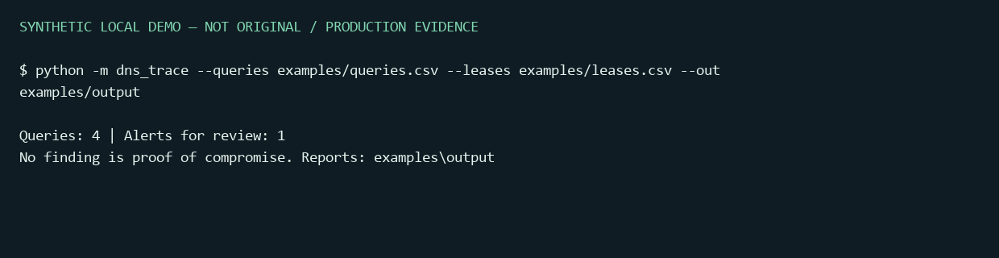

# DNS Trace Investigator

Offline DNS evidence triage with time-aware DHCP correlation, traceable rows and conservative findings.
Personal project by **Alef Kaue Santos Nunes**, developed with AI assistance.
[Português](README.pt-BR.md) · [Investigation model](docs/investigation-model.md)



## Quick start

Python 3.11+; no third-party runtime dependencies:

```console
python -m dns_trace --queries examples/queries.csv --leases examples/leases.csv --out examples/output
python -m unittest discover -s tests -v
```

The synthetic example yields **one alert for analyst review**, not a proven compromise.
Reports: JSON, Markdown and escaped static HTML. Optional installation: `python -m pip install .`,
then `dns-trace --help`.

## What it does

- Normalizes CSV/JSON query events with timezone-aware timestamps and validated IPs/names.
- Recognizes exported TShark fields as well as the compact input schema.
- Finds long, high-entropy label bursts in a **sliding time window**, including across minute boundaries.
- Correlates source addresses to DHCP intervals; preserves ambiguous or absent attribution.
- Records source SHA-256, evidence row numbers, thresholds and the event timeline.
- Redacts query labels by default; an explicit `--reveal-payload` enables local bounded base32 previews.
- Applies allowlists using DNS label boundaries, not unsafe substring matching.

```console
python -m dns_trace --queries examples/queries.csv --window 30 --threshold 3 --allow trusted.example
```

## Input contract

Queries need `timestamp`, `src_ip`, `query`. JSON is an array of those objects. Timestamps must
include a timezone or be Unix seconds. DNS labels must be ASCII/punycode; response records can
be excluded with `dns.flags.response`. DHCP rows need `src_ip`, `hostname`, `start`, `end`.
The lease end is exclusive; overlapping hostnames remain ambiguous.

The example uses documentation-only IP addresses and `.example` domains. No real captured
traffic, original CTF infrastructure or payload is included. Inputs are bounded to 10 MB;
malformed rows fail rather than silently producing an apparently clean analysis.

## Work with an owned PCAP

The project intentionally uses Wireshark's mature parser rather than implementing another packet
decoder or adding a privileged capture service. Export only the relevant fields from a local file:

```console
tshark -r owned-capture.pcap -Y "dns.flags.response == 0 && dns.qry.name" -T fields -e frame.time_epoch -e ip.src -e ipv6.src -e dns.qry.name -E header=y -E separator=, -E quote=d -E occurrence=f > queries.csv
python -m dns_trace --queries queries.csv --out private-reports
```

This command reads an existing file; it does not start capture. `occurrence=f` chooses the first
question, so unusual multi-question packets may need separate analysis. The tool itself never
executes TShark or sends a DNS request. A hand-crafted export fixture is tested; the actual TShark
binary/PCAP integration has not been exercised on the development machine.

## Interpretation and limitations

An alert means a pattern matched configured heuristics. CDNs, telemetry, antivirus products,
DNSSEC-related behavior and legitimate encodings may look similar. Investigate endpoint process
context, resolver visibility, query types and collection quality before attributing exfiltration.

Grouping by the final two labels is a **display heuristic, not public-suffix/domain ownership logic**.
DHCP attribution is address/time evidence, not authenticated user identity. NAT, clock drift,
DoH/DoT, retransmissions, missing packets and fragmented visibility can change the interpretation.
The tool does not auto-block hosts, query reputation services or execute recovered text.

## Why a separate project?

This complements existing SSH, generic-event and IOC tools by focusing on DNS payload indicators,
sliding windows and DHCP ownership. It translates the CTF's evidence-correlation lesson into a small
defensive workflow without claiming operation in a production SOC.

Tests cover timing boundaries, attribution ambiguity, allowlist bypasses, payload redaction,
normal traffic, invalid data, report provenance and CLI generation. CI runs on Windows/Linux.

References: [TShark manual](https://www.wireshark.org/docs/man-pages/tshark.html),
[OWASP logging guidance](https://cheatsheetseries.owasp.org/cheatsheets/Logging_Cheat_Sheet.html).
MIT license for original code/documentation.
