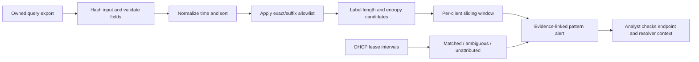

# Evidence-oriented investigation model

The rule is intentionally understandable: long, varied labels repeated within a bounded time window.
It is a triage heuristic, not a learned classifier or proof of encoded exfiltration. The report carries
thresholds so a reviewer can reproduce the decision. Original input row numbers survive sorting.

Hashing gives provenance for a particular file, not chain-of-custody authentication. Preserve originals,
record collection authorization and time synchronization, and keep real reports outside public Git.
Encoded labels can contain secrets; default reports omit the label and retain a hash, size and entropy.
Source addresses, hostname candidates and domain hints may still be sensitive in a real environment.

Attribution intervals use `start <= event < end`. Reused addresses are evaluated at the event time;
overlapping names are kept as candidates. A host match does not establish a person's identity.
Burst detection retains one peak per client/domain hint rather than every overlapping alert.

## Interview walkthrough

1. Run the example and inspect the three evidence rows and source hash.
2. Move one timestamp outside the window and explain the changed result.
3. Add a conflicting DHCP lease and show ambiguous attribution.
4. Explain why entropy alone also detects benign telemetry.
5. Show the allowlist-boundary test and the difference between decoding and executing payloads.
